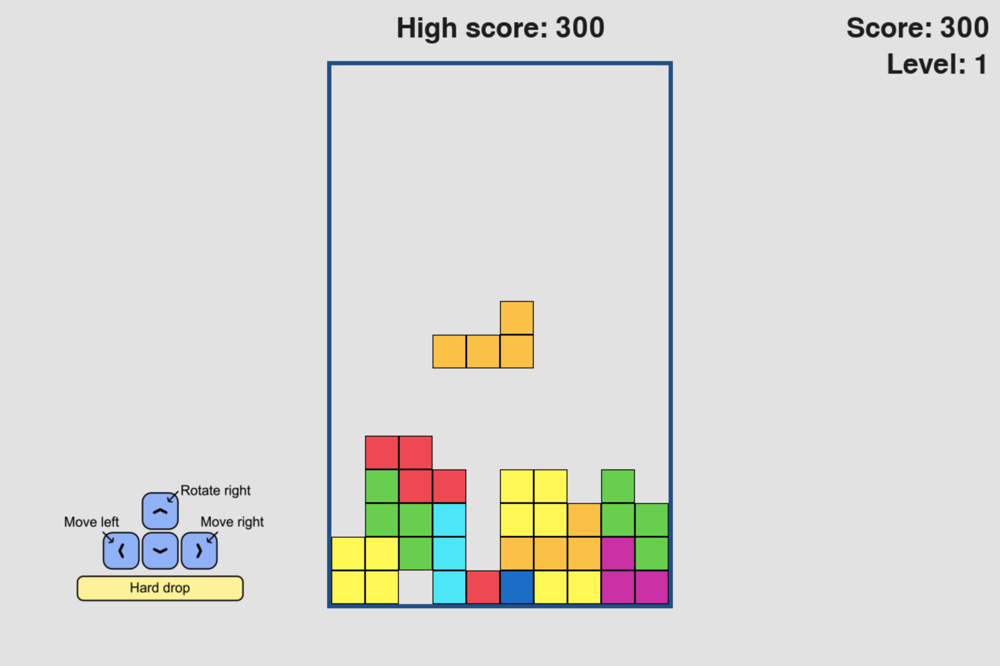

# Block puzzle
A personal pygame project inspired by Tetris-style gameplay.

Prevent the falling blocks from stacking up to the top by arranging them to fill 
out horizontal lines.

---

## Screenshots



---

## Features

- Classic Tetris-style gameplay and block shapes
- Difficulty increases each time 10 rows were filled
- Scoreboard shows current score, current level and high-score
- Controls are displayed during gameplay
- Game over and restart functionality

--- 

## Technologies used

- Programming: Python 3, pygame
- Creating assets: Affinity Designer 2

## Installation

### 1. Clone the repository

```bash
git clone https://github.com/a-glig/block-puzzle-game.git
cd block-puzzle-game
```

### 2. Install dependencies

```bash
pip install -r requirements.txt
```

### 3. Run the game

```bash
python block_puzzle.py
```

---

## Controls 

- Up Arrow : Rotate right 
- Left Arrow : Move left 
- Right Arrow : Move right 

- Space : Hard Drop 

---

## What I Learned

This project helped me practice:

- Object-oriented programming in Python
- Game loops 
- Collision detection
- Sprite groups in pygame
- Structuring larger Python projects

---

## Future Improvements

- Include preview window displaying next block
- Add more control settings

---

## Credits

This project was inspired by concepts and techniques presented in the book 
"Python Crash Course - 3rd Edition" by Eric Matthes. While following the book's
development of a different game as a learning exercise, I applied the ideas 
independently to create this project.

---

## License

This project is licensed under the MIT License.